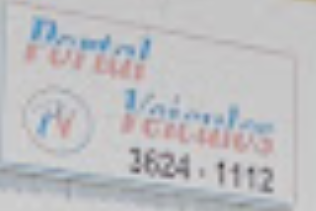

# Manual de identidade visual — Portal Veículos

Este manual registra a identidade que já aparece no site e define uma direção coerente para materiais e telas futuras. Os valores marcados como **atual** vêm da implementação; os marcados como **proposta** são recomendações para completar o sistema, não funcionalidades já implementadas.

## Essência da marca

**Posicionamento:** revenda local, experiente e próxima, com foco em confiança, transparência e bons negócios.

**Personalidade visual:** próxima, reconhecível e confiável. A referência apresenta o nome em azul com um acento coral/vermelho; aplique esses dois tons à marca e mantenha os neutros frios suaves para garantir legibilidade.

**Tom de voz:** português brasileiro simples, próximo e seguro. Priorize informações concretas, evite exageros e deixe preços, condições e próximos passos claros.

## Logotipo

### Arquivo de referência recebido

A imagem fornecida parece ser uma foto pequena e desfocada de um cartão, com lettering azul e coral/vermelho e um símbolo circular. Ela serve como **referência visual**, mas não como arquivo de produção: os contornos e as cores não têm qualidade suficiente para reprodução fiel nem para amostragem exata.

- Não redesenhe o lettering, não extraia cores exatas nem amplie essa imagem para impressão.
- Solicite o arquivo-mestre original em SVG, PDF ou PNG de alta resolução antes de produzir peças oficiais.
- Até receber o original, use a marca digital do site: monograma circular “PV” em azul, com “Portal” azul e “Veículos” coral em lettering cursivo.
- Preserve a proporção e o contraste da marca digital; não aplique sombras, gradientes ou inclinação.
- Em fundos escuros, clareie o azul para manter contraste e mantenha o coral legível. Em fundos claros, use os tons principais da marca.
- Não combine o lettering antigo do cartão com a marca digital do site em uma mesma composição.

O cabeçalho atual monta a marca com texto e CSS; ainda não existe um logotipo vetorial oficial nos arquivos públicos do frontend. A tipografia e a paleta digitais são aproximações visuais, não uma reprodução oficial do lettering fotografado.

## Cores

### Tema claro — atual

| Token | Cor | Uso |
|---|---|---|
| Azul-marinho — `--ink` | `#1D3D52` | Texto principal, cabeçalho/rodapé escuros e contraste |
| Azul da marca — `--brand-blue` | `#087FB5` | Monograma, ações principais e detalhes de marca |
| Azul hover — `--brand-blue-hover` | `#066590` | Estado hover das ações principais |
| Azul claro — `--brand-blue-light` | `#75C2ED` | Acentos de marca sobre fundos escuros |
| Coral — `--brand-coral` | `#B74345` | “Veículos”, etiquetas e indicadores |
| Papel frio — `--paper` | `#F4F7F9` | Fundo principal e páginas de detalhe |
| Branco — `--white` | `#FFFFFF` | Cabeçalho e superfícies dos cartões |
| Cinza médio — `--muted` | `#687781` | Descrições, legendas e informação secundária |
| Linha — `--line` | `#D9E2E8` | Bordas, divisores e contornos sutis |

Os valores digitais são aproximações escolhidas a partir da foto de baixa resolução; confirme-os com o arquivo-mestre oficial antes de impressão ou produção de marca.

### Tema escuro — atual

O botão de tema no cabeçalho alterna entre os modos claro e escuro. A escolha fica salva no navegador para a próxima visita. A imagem do hero mantém um overlay azul-marinho para preservar a leitura do texto.

| Token | Cor | Uso |
|---|---|---|
| Fundo — `--paper` | `#151F26` | Fundo da página e da área de detalhes |
| Superfície — `--surface` | `#24343F` | Cartões, filtros e painéis |
| Cabeçalho — `--header-bg` | `#1D2A33` | Fundo do cabeçalho |
| Rodapé — `--footer-bg` | `#10181E` | Fundo do rodapé |
| Texto principal — `--ink` | `#EDF4F7` | Títulos e conteúdo |
| Texto secundário — `--muted` | `#BAC8D0` | Descrições e metadados |
| Linha — `--line` | `#3B4D58` | Bordas e separadores |
| Azul — `--brand-blue` | `#20A5E0` | Marca, links e ações principais |
| Azul hover — `--brand-blue-hover` | `#1685BA` | Estado hover das ações |
| Azul claro — `--brand-blue-light` | `#8CD6FF` | Acentos sobre fundos escuros |
| Coral — `--brand-coral` | `#FF817D` | Acentos da marca e foco |

Mantenha azul e coral como acentos nos dois temas. Use o texto claro definido para fundos escuros e valide contraste em todos os estados interativos.

## Tipografia

- **Lobster**: lettering da marca “Portal Veículos” e monograma. Aproxima o caráter cursivo da referência; use apenas em pequenas áreas de marca.
- **Lato** (`400`, `700`, `900`): títulos, texto corrido, navegação, botões, descrições e metadados. É a fonte de interface para leitura confortável.
- As fontes são carregadas do Google Fonts em `frontend/src/index.css`. Se o projeto precisar funcionar sem rede ou tiver requisitos de privacidade, hospede localmente os arquivos licenciados.
- Use sentence case para títulos e frases. Reserve caixa alta para etiquetas curtas, como “VEÍCULOS · CANOINHAS”.
- Mantenha hierarquia: título de hero grande e expressivo; títulos de seção intermediários; descrições e metadados menores, mas confortáveis para leitura.

Referências de tamanho atuais: título do hero 38 px (30 px em telas pequenas); cartão 18 px; texto de descrição 13–16 px. Preserve o lettering Lobster para a marca, não para blocos longos nem preços.

## Fotografia e imagens

### Hero

O hero atual segue a composição centralizada do wireframe, com fundo claro e acentos abstratos discretos em azul e coral. A foto local `frontend/src/assets/fachada_pv.jpg` permanece disponível, mas não é usada nessa área.

- Se uma fotografia voltar a ser usada no hero, escolha uma imagem realista e bem iluminada, com espaço para o texto e enquadramento responsivo.
- Mantenha o título e as informações do hero centralizados em desktop e mobile.

### Fotos de veículos

- Use a foto real do veículo anunciado; ela deve ser fiel ao item e não pode induzir o comprador a erro.
- Padronize a orientação, iluminação e fundo sempre que possível. Evite filtros pesados, marcas d’água sobre o veículo e colagens.
- Os cartões usam proporção **16:10** com `object-fit: cover`; a página de detalhe usa uma imagem maior em **16:9** e muda para **4:3** no mobile.
- Confira o recorte em desktop e celular. Não corte rodas, frente ou traseira de forma que altere a percepção do veículo.
- O texto alternativo deve identificar o veículo, como já faz o componente de cartões.

### Placeholder

O seed de teste do backend gera um SVG com carro estilizado em verde, sobre fundo cinza-esverdeado. É uma imagem **provisória para dados de teste**, não uma peça final de identidade nem uma foto de anúncio.

Quando uma imagem não estiver disponível, use um placeholder neutro, sem marca de fabricante, com proporção e fundo consistentes. Informe claramente que a imagem é ilustrativa quando houver risco de confusão com uma foto real.

## Interface e componentes

- **Ações primárias:** fundo azul da marca, texto branco, peso 700; use para a ação mais importante da tela.
- **Ações secundárias:** superfície clara, borda cinza e texto carvão. O estado selecionado do filtro usa azul da marca com texto claro.
- **Cartões de veículo:** fundo branco, borda fina e quadrada, com imagem no topo. Elevação e movimento no hover devem ser sutis.
- **Etiquetas:** pequenas, em caixa alta, com espaçamento e contraste suficientes; use azul-claro sobre fundo escuro no hero e coral em superfícies claras.
- **Cabeçalho:** fundo claro, marca à esquerda e navegação à direita. **Rodapé:** fundo carvão, texto claro e informações organizadas.
- **Ícones e setas:** simples e funcionais; mantenha os sinais direcionais usados nos CTAs sem competir com o texto.
- **Bordas e cantos:** linhas delicadas e cantos modestos. Evite superfícies excessivamente arredondadas ou sombras pesadas.

### Layout e responsividade

- Use conteúdo centralizado com largura máxima de aproximadamente **1200 px**.
- Em desktop, a listagem atual comporta quatro cartões por linha; em tablet, dois; em telas estreitas, um.
- As margens laterais passam de 32 px em telas maiores para 20 px em telas pequenas.
- Reduza a tipografia e reorganize blocos antes de comprimir conteúdo ou criar rolagem horizontal.
- Respeite o movimento reduzido do sistema ao usar animações; a entrada atual desloca elementos poucos pixels e dura menos de um segundo.

## Acessibilidade e conteúdo

- Mantenha contraste suficiente entre texto e fundo, principalmente para textos pequenos e estados desabilitados. Azul e coral são acentos, não cores para texto longo sobre qualquer fundo.
- Preserve foco de teclado visível e não indique seleção somente por cor; os filtros também expõem o estado com `aria-pressed`.
- Forneça texto alternativo útil para imagens de veículos; imagens decorativas não devem repetir informação do texto ao redor.
- Não coloque textos essenciais dentro da fotografia do hero.
- Escreva preços, categoria, ano e condições de maneira consistente e verificável.

## Checklist rápido

- [ ] A marca usada é a versão digital aprovada ou o arquivo-mestre oficial?
- [ ] A composição segue a paleta do tema e mantém contraste legível?
- [ ] A marca usa Lobster e o texto de interface usa Lato?
- [ ] As fotos representam fielmente os veículos e mantêm recortes apropriados?
- [ ] Placeholders estão claramente separados de imagens reais?
- [ ] O layout, os focos de teclado e as ações funcionam em telas pequenas?
